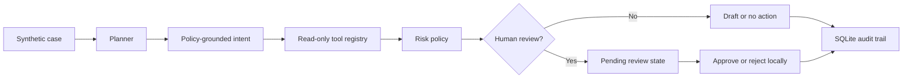

# AgentOps Reference — Operational AI Agents with Human Approval

**Frank Yip | Independent engineering portfolio demo**

A **runnable local-first reference implementation** demonstrating how I think about reliable operational agents: evidence retrieval, constrained planning, policy enforcement, idempotency, human review, traceability and repeatable evaluation.

> **Source provenance:** This is independently authored demo code using five wholly synthetic order-support scenarios, **not** proprietary code from Watchdives, MolGraph, or Sticker Mule. It is not a deployed customer system. All example results are simulated.

## Demo in 90 seconds

```bash
python3.11 -m venv .venv
source .venv/bin/activate               # Windows: .venv\\Scripts\\activate
python -m pip install -e '.[dev]'
python -m uvicorn agent_ops.api:app --host 127.0.0.1 --port 8000
```

Open **http://127.0.0.1:8000** in a browser. No account, API key, external service, or production data is required.

1. Select **SYN-1001**, run the workflow; observe a read-only shipping lookup and **draft-only** recommendation.
2. Select **SYN-1004**, run the workflow; an address change is blocked behind a human review state. Click approval; it only changes **local approval state**, never the real order.
3. Click **Replay same key**; observe the original action returned and no duplicate audit creation.
4. Run the **offline five-case evaluation**; it reports the deterministic regression result, not LLM performance.

The UI can be screen-shared in a short technical walkthrough. API docs: http://127.0.0.1:8000/docs

## Architecture



**Key engineering decisions**

- **Policy over model:** A model can optionally suggest classification, but deterministic source-of-truth checks and risk policy always decide what is permitted.
- **Explicit tools:** Only `lookup_order`, `lookup_shipping`, and `lookup_artwork` are allowed. No tool executes payments, customer messages or order modifications.
- **Review boundary:** Artwork, address and billing changes are sent to human review. Approval is recorded without any side effect.
- **Idempotency:** `(case_id, idempotency_key)` is unique in SQLite; retries return the existing action.
- **Audit trail:** Every created plan and reviewer decision leaves a local audit event.
- **Evaluation:** A fixed five-case golden set checks policy behavior; tests cover adversarial request text, replay, authorization checks and forbidden tools.

## Test and inspect

```bash
python -m pytest -q
curl -s http://127.0.0.1:8000/api/evaluation
curl -s http://127.0.0.1:8000/api/cases
curl -s -X POST http://127.0.0.1:8000/api/cases/SYN-1001/run \
     -H 'content-type: application/json' \
     -d '{"idempotency_key":"example-001"}'
```

The application uses **Python, FastAPI, Pydantic, SQLite, and pytest**. The dashboard is plain HTML/CSS/JS and ships with no frontend build tooling. GitHub Actions runs the tests on each push.

### Optional model-backed classification (disabled by default)

```bash
export AGENT_PLANNER=llm
export OPENAI_API_KEY=...   # set locally; never commit credentials
export OPENAI_MODEL=gpt-4.1-mini
```

The planner will call a compatible model API using **only synthetic demo case fields**. Model outputs are schema-validated and cross-checked against the deterministic policy classification. Errors or disagreements fall back safely. The dashboard shows the actual planner mode.

## Why these examples?

The exercise is inspired by common workflows in e-commerce and print-on-demand fulfillment: missing or late shipment updates, artwork proof review, address changes, and billing questions. They are candidate automation opportunities—not claims about Sticker Mule's actual process, internal pain points, or existing automation.

## What this demonstrates and does not

The repository demonstrates software design and testable safety boundaries. It **does not prove** production performance, improved customer metrics, or a deployed autonomous agent. For security and reliability limitations, read [LIMITATIONS.md](LIMITATIONS.md).

**Contact:** Frank Yip · [Portfolio](https://molgraph.com/portfolio/frank-yip)
